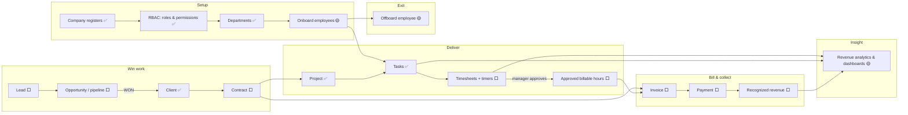
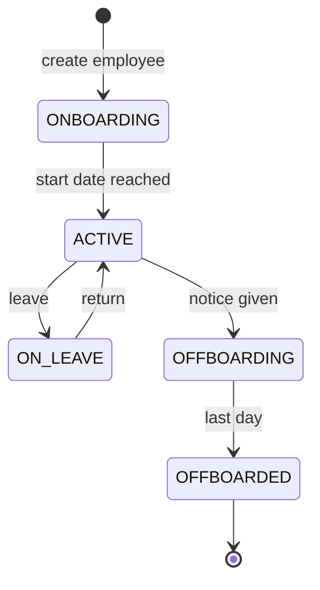
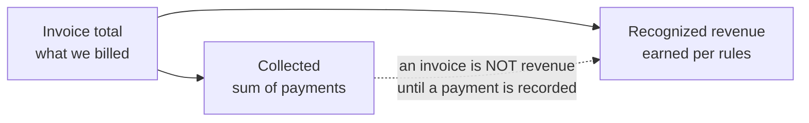

# RevenueOS — End-to-End Company Flow

How the whole platform fits together: a company signs up, brings people on,
wins work, delivers it, bills for it, collects revenue, and eventually offboards
people. Each stage is backed by one or more modules; the arrows are the
handoffs we wire between them.

Legend: ✅ built · 🟡 in progress · ⬜ planned

---

## 1. The company lifecycle (onboard → operate → bill → offboard)

## 2. People lifecycle (the "onboard to deboard" spine)

An employee's `employmentStatus` drives this. Offboarding sets the end date and
removes the person from active utilization/assignment while keeping history.

## 3. The money is kept honest

Three different numbers, never conflated (per the spec):

- **Project profit** = project revenue − (labour cost from approved hours ×
  employee `costRate` + direct expenses).
- **Employee utilization** = billable hours ÷ available hours.
- These are **computed**, never stored as denormalized totals.

## 4. Module status map

| Stage | Module | Status |
| ----- | ------ | ------ |
| Setup | Auth, Organizations, Users, Roles, Permissions (RBAC) | ✅ |
| Setup | Departments | ✅ (API 🟡) |
| People | Employees (onboard/offboard lifecycle) | 🟡 |
| Win work | Leads, Opportunities (sales pipeline) | ⬜ |
| Win work | Clients (CRM) | ✅ |
| Win work | Contracts | ⬜ |
| Deliver | Projects | ✅ |
| Deliver | Tasks | ✅ |
| Deliver | Timesheets + work timers + approvals | ⬜ |
| Bill | Invoices, Payments, Expenses | ⬜ |
| Insight | Revenue analytics, role dashboards, reports | 🟡 (dashboard shell ✅) |
| Platform | Notifications, Audit log | ⬜ |

## 5. Build order to reach "complete" (onboard → billing)

1. **Employees + Departments** — the people spine (onboarding → offboarding). 🟡
2. **Timesheets + timers + approval** — turn work into approved billable hours.
3. **Contracts + Invoices + Payments** — bill approved hours / fixed fees, record collection.
4. **Expenses** — project costs for profitability.
5. **Sales: Leads + Opportunities** — the top of the funnel feeding Clients → Projects.
6. **Revenue analytics + role dashboards + reports/export** — the leadership view.
7. **Notifications + approvals inbox + audit log** — the cross-cutting glue.

Each module ships the same way: entity → Flyway migration → tenant-scoped API
(permission-guarded) → regenerate the typed client (Kubb) → screens → tests →
commit on a feature branch → merge.
