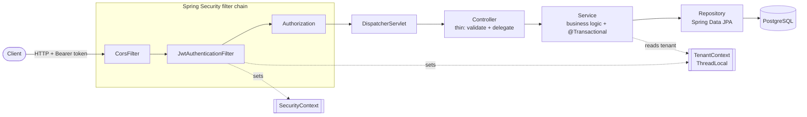
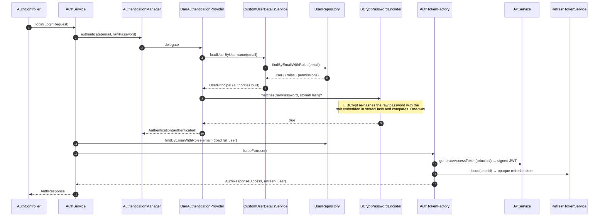
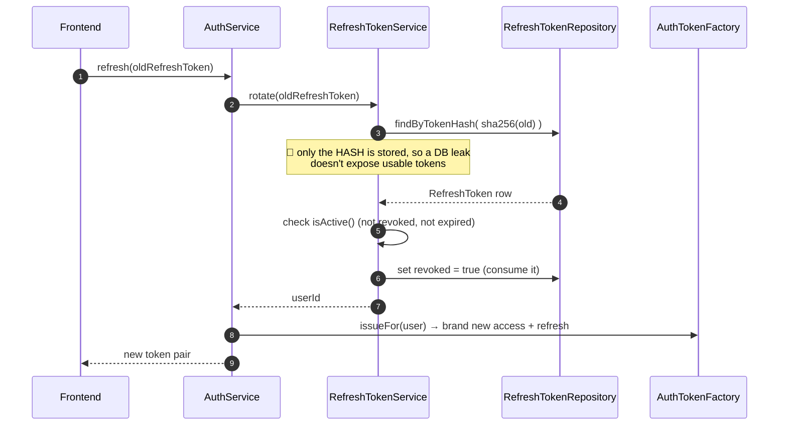
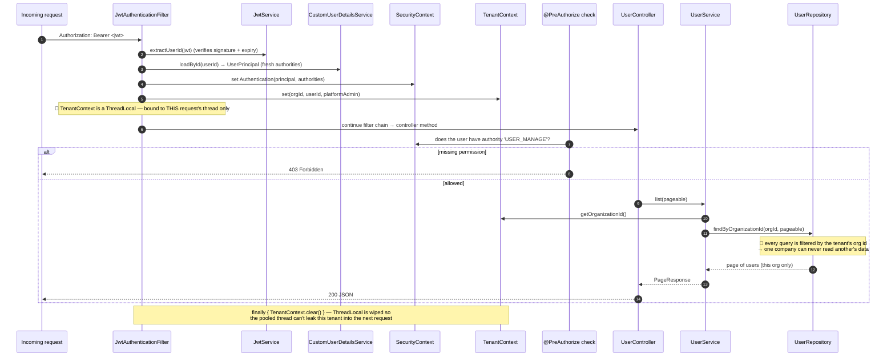
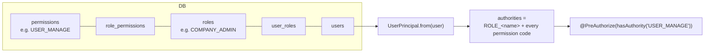
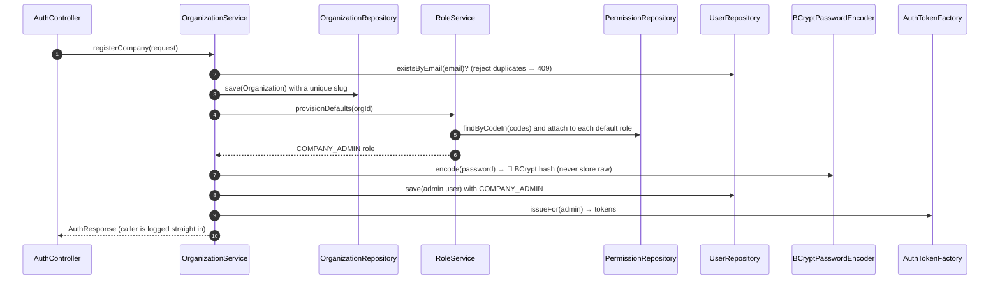

# RevenueOS Backend — How It Works (learn-fast guide)

This explains the backend end to end: the layers, which class calls which, which
repository each service uses, and — most importantly — **how JWT, Spring
Security, RBAC and multi-tenancy work internally**. Diagrams are mermaid (render
on GitHub / IDE preview). Code blocks carry `// 🔎` comments at the points that
matter.

---

## 1. The big picture (layers + one request's journey)



**Rule of the codebase:** controllers stay thin (map HTTP ↔ DTO, declare
permissions); all real work lives in services; repositories only run queries and
are **always scoped by the tenant's `organization_id`**.

---

## 2. Package map (feature-first)

```
com.revenueos
├── config/        AppProperties (typed app.* config), OpenApiConfig (Swagger)
├── security/      JWT + Spring Security wiring  ← the "how auth works" package
├── tenant/        TenantContext (current org/user for the request)
├── common/        BaseEntity, TenantAwareEntity, exceptions, Tokens (hashing)
├── auth/          login / refresh / logout / password reset / me
│   └── token/     RefreshToken + PasswordResetToken (entities + rotation service)
├── organization/  company registration + org settings
├── user/          user CRUD + role assignment
├── role/          roles + default role catalog (RBAC)
├── permission/    permission catalog
├── department/    (entity only for now)
└── audit/         audit log entity
```

---

## 3. LOGIN — what calls what, step by step

`POST /api/v1/auth/login`



### Annotated: `AuthService.login`

```java
public AuthResponse login(LoginRequest request) {
    // 🔎 This single call does the whole password check. If the password is wrong
    //    it throws BadCredentialsException → GlobalExceptionHandler turns it into 401.
    authenticationManager.authenticate(
            new UsernamePasswordAuthenticationToken(request.email(), request.password()));

    // Password is valid here. Load the user WITH roles+permissions so the token
    // payload and the AuthUser can list them.
    User user = userRepository.findByEmailWithRoles(request.email())
            .orElseThrow(() -> new BadCredentialsException("Invalid email or password"));

    return authTokenFactory.issueFor(user);   // mints access + refresh tokens
}
```

> 🔎 **Why `AuthenticationManager` and not a manual check?** It delegates to
> `DaoAuthenticationProvider`, which (a) loads the user via
> `CustomUserDetailsService`, (b) compares passwords with `BCryptPasswordEncoder`,
> and (c) checks the account isn't disabled — all the standard Spring Security
> plumbing, for free.

---

## 4. JWT internals — how the token is built and verified

A JWT is three base64url parts joined by dots: `header.payload.signature`.

```
eyJhbGciOiJIUzI1NiJ9 . eyJzdWIiOiI8dXNlci1pZD4iLCJvcmdJZCI6Ii4uLiJ9 . <HMAC-SHA256 signature>
        header                         payload (claims)                      signature
```

### Signing (on login/refresh) — `JwtService.generateAccessToken`

```java
return Jwts.builder()
        .issuer(issuer)                                   // "revenue-os"
        .subject(principal.getId().toString())            // 🔎 sub = the user id (who)
        .claim("orgId", principal.getOrganizationId())    // 🔎 tenant the user belongs to
        .claim("email", principal.getUsername())
        .claim("platformAdmin", principal.isPlatformAdmin())
        .issuedAt(now)
        .expiration(Date.from(now.plusSeconds(accessTtlSeconds)))  // 🔎 short life (15 min)
        .signWith(key)                                    // 🔎 HMAC-SHA256 with the server secret
        .compact();
```

> 🔎 **What `signWith(key)` actually does:** it computes
> `HMAC_SHA256(base64(header) + "." + base64(payload), secret)` and appends it as
> the signature. The secret (`app.jwt.secret`, a base64 256-bit key) **never
> leaves the server**. Anyone can *read* a JWT (it's not encrypted), but only the
> server can produce a valid signature — so nobody can forge or tamper with one.

### Verifying (on every request) — `JwtService.parse`

```java
return Jwts.parser()
        .verifyWith(key)        // 🔎 recomputes the HMAC with the secret and compares signatures
        .requireIssuer(issuer)  // 🔎 rejects tokens not issued by us
        .build()
        .parseSignedClaims(token)   // 🔎 also checks `exp` → throws if expired
        .getPayload();
```

If the signature is wrong, the token was tampered with → exception → 401. If
`exp` has passed → exception → 401 (and the frontend then calls `/refresh`).

> 🔎 **This is "stateless" auth:** the server stores nothing about access tokens.
> It trusts them purely because the signature verifies. That's why access tokens
> are short-lived — you can't revoke one early, so you keep its window small.

---

## 5. Access vs refresh tokens (two very different things)

| | Access token (JWT) | Refresh token |
| --- | --- | --- |
| Format | Signed JWT (self-describing) | Opaque random string |
| Stored server-side? | **No** (stateless) | **Yes** — only its SHA-256 **hash**, in `refresh_tokens` |
| Lifetime | ~15 min | ~7 days |
| Sent on | every API call | only to `/auth/refresh` |
| Revocable? | no (short life instead) | yes (flip `revoked = true`) |

### Refresh rotation — `RefreshTokenService`



> 🔎 **Why rotate?** Each refresh token is single-use. If someone steals one and
> uses it, the legitimate client's next refresh fails (already revoked) — a
> built-in tripwire for token theft.

---

## 6. An AUTHENTICATED request — filter → context → authorization

`GET /api/v1/users` (needs the `USER_MANAGE` permission)



### Annotated: `JwtAuthenticationFilter.doFilterInternal`

```java
UUID userId = jwtService.extractUserId(token);       // 🔎 throws if signature/expiry invalid → stays anonymous
if (SecurityContextHolder.getContext().getAuthentication() == null) {
    UserPrincipal principal = userDetailsService.loadById(userId);   // 🔎 reload from DB → permission changes take effect immediately
    var auth = new UsernamePasswordAuthenticationToken(principal, null, principal.getAuthorities());
    SecurityContextHolder.getContext().setAuthentication(auth);      // 🔎 now @PreAuthorize can see the user
    TenantContext.set(principal.getOrganizationId(), principal.getId(), principal.isPlatformAdmin());
}
// ... filterChain.doFilter(...) ...
// finally: TenantContext.clear();   // 🔎 MUST clear — threads are reused across requests
```

---

## 7. RBAC internals — from permission rows to `@PreAuthorize`



### Annotated: `UserPrincipal.from`

```java
user.getRoles().forEach(role -> {
    authorities.add(new SimpleGrantedAuthority("ROLE_" + role.getName()));   // role as authority
    role.getPermissions().forEach(p ->
        authorities.add(new SimpleGrantedAuthority(p.getCode())));           // 🔎 each permission code IS an authority
});
```

So `@PreAuthorize("hasAuthority('USER_MANAGE')")` on a controller just asks "does
this principal's authority set contain `USER_MANAGE`?". Permissions are data in
the DB, not hardcoded roles — admins can build custom roles and the checks keep
working.

> 🔎 **Default roles** are created per company at registration by
> `RoleService.provisionDefaults()` using `DefaultRoleCatalog` (COMPANY_ADMIN gets
> every permission; EMPLOYEE gets a handful; etc.).

---

## 8. Multi-tenancy internals — how companies stay isolated

Every tenant-owned table has an `organization_id` (via `TenantAwareEntity`). The
id comes from the **JWT**, is placed in `TenantContext`, and **every** service
reads it from there — never from the request body or a path param.

```java
// TenantAwareEntity — the shared column
@Column(name = "organization_id", nullable = false, updatable = false)
private UUID organizationId;

// A service always scopes by the current tenant:
public UserResponse get(UUID id) {
    return userMapper.toResponse(
        userRepository.findByIdAndOrganizationId(id, TenantContext.getOrganizationId())  // 🔎 org from token, not client
            .orElseThrow(() -> ResourceNotFoundException.of("User", id)));
}
```

> 🔎 **The attack this blocks:** a user from company A requests
> `/users/{B's user id}`. The query is `WHERE id = ? AND organization_id = A`, so
> B's row isn't returned → 404. Even though the id is valid, cross-tenant access
> is impossible because the org id is taken from the verified token, not the URL.

---

## 9. COMPANY REGISTRATION — the one flow that creates a tenant

`POST /api/v1/auth/register-company` (public)



Everything runs inside one `@Transactional` — if any step fails, the org, roles
and user all roll back together.

---

## 10. Endpoint → Controller → Service → Repository (cheat sheet)

| Endpoint | Controller | Service | Repositories used |
| -------- | ---------- | ------- | ----------------- |
| `POST /auth/login` | `AuthController` | `AuthService` | `UserRepository`, `RefreshTokenRepository` |
| `POST /auth/refresh` | `AuthController` | `AuthService` → `RefreshTokenService` | `RefreshTokenRepository`, `UserRepository` |
| `POST /auth/logout` | `AuthController` | `AuthService` → `RefreshTokenService` | `RefreshTokenRepository` |
| `POST /auth/forgot-password` | `AuthController` | `AuthService` | `UserRepository`, `PasswordResetTokenRepository` |
| `POST /auth/reset-password` | `AuthController` | `AuthService` | `PasswordResetTokenRepository`, `UserRepository`, `RefreshTokenRepository` |
| `GET /auth/me` | `AuthController` | `AuthService` | `UserRepository` |
| `POST /auth/register-company` | `AuthController` | `OrganizationService` → `RoleService` | `OrganizationRepository`, `PermissionRepository`, `UserRepository` |
| `GET/POST/PUT /users` | `UserController` | `UserService` | `UserRepository`, `RoleRepository` |
| `GET/POST/PUT/DELETE /roles` | `RoleController` | `RoleService` | `RoleRepository`, `PermissionRepository` |
| `GET /permissions` | `PermissionController` | `PermissionService` | `PermissionRepository` |
| `GET/PUT /organizations/{id}` | `OrganizationController` | `OrganizationService` | `OrganizationRepository` |

---

## 11. Class responsibilities (one-liners)

| Class | Job |
| ----- | --- |
| `SecurityConfig` | Builds the filter chain, public paths, CORS, password encoder, enables `@PreAuthorize`. |
| `JwtAuthenticationFilter` | Per request: verify token → set `SecurityContext` + `TenantContext` → clear after. |
| `JwtService` | Sign access tokens; verify + parse them (HMAC-SHA256 with the server secret). |
| `CustomUserDetailsService` | Load a user (by email or id) and turn it into a `UserPrincipal` with authorities. |
| `UserPrincipal` | Spring Security's view of a user; flattens roles+permissions into authorities. |
| `AuthTokenFactory` | Build the `AuthResponse`: access JWT + rotated refresh token + user payload. |
| `RefreshTokenService` | Issue / rotate / revoke opaque refresh tokens (stored hashed). |
| `TenantContext` | ThreadLocal holding the current org/user id for tenant-scoped queries. |
| `GlobalExceptionHandler` | Map exceptions → clean RFC-7807 JSON (401/403/404/409/400). |

---

## 12. One-line mental model

> **The JWT proves *who* you are and *which company* you're in (signature +
> claims); Spring Security turns that into authorities for `@PreAuthorize`; and
> `TenantContext` makes every query silently scope to your company.**
